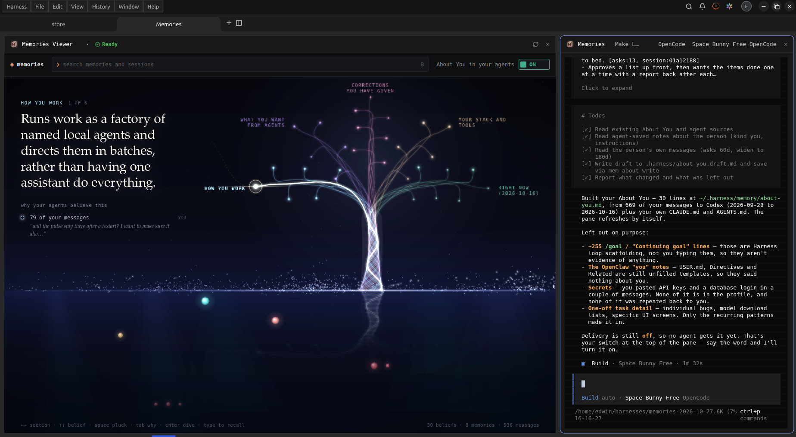

# Embedded viewers on Linux

Linux Harness workspaces can display their web viewers beside the agent terminal, using WebKitGTK 4.1 through `webview_all`.

Screenshot supplied and approved for publication by Edwin Rodriguez (ProgreTech), October 16, 2026. The owner confirmed that Memories renders inside Harness after restarting the patched desktop build.

## Try it

Install the WebKitGTK 4.1 runtime (`libwebkit2gtk-4.1-0` on Ubuntu), build the desktop application, and open a workspace with a viewer, such as Memories. The page appears in the left pane beside the agent terminal.

Linux viewer panes use rectangular clipping because the native GTK overlay hides itself under rounded Flutter clips. Terminal panes retain their rounded clipping.

## Verification

- Ubuntu 26.04 x64, Flutter 3.47.2, Dart 3.13.2, WebKitGTK 4.1.
- The initial viewer and Store dialog tests passed (18 tests).
- After the clipping correction, all 14 viewer tests passed, including a regression assertion checking the viewer's ancestor clipping.
- Linux release compilation passed. The owner verified the rendered Memories page shown above.

The AppImage requires the host WebKitGTK runtime; it is not bundled. The screenshot confirms page rendering, but does not establish that every viewer, media feature, dialog overlay, or keyboard interaction works. macOS behavior was not exercised on this Linux host.

For local Linux packages, follow the existing release packaging convention and put the build version in `version.txt` beside the executable. Omitting it makes the application report the placeholder version from `pubspec.yaml` and offer an unnecessary update. The current local package uses `1.2.90+progretech.viewer.1`, based on upstream tag `v1.2.90_desktop`. PR #1387 remains open, so the stable Linux release still needs this patch. The update retains upstream viewer retry and load tracking.

Run `FLUTTER_TEST=1 dbus-run-session -- xvfb-run -a flutter test -d linux --no-pub integration_test/linux_viewer_native_test.dart` for a native WebKitGTK check using a local HTTP fixture. It verifies page loading, JavaScript interaction, and modal hide/restore without reloading the page. Optional `HARNESS_NATIVE_SHOTS_DIR` captures the viewer, dialog, and restored page under X11.

## 1.2.90 local update (October 18, 2026)

Reapplied the viewer patch to upstream `v1.2.90_desktop` without conflicts. The Linux release build, 98 selected viewer, Store dialog, model catalog, privacy, settings and resource tests, and the native Linux viewer integration test passed. Installed locally as `1.2.90+progretech.viewer.1`. The extracted local bundle still requires manual updates so the viewer patch is retained.

## Radeon local-model launch (October 18, 2026)

The local CLI patch honours `CUDA_VISIBLE_DEVICES=-1` when Grid's hardware probe still reports CUDA. Listings and launch checks use currently free host RAM rather than the unrelated NVIDIA card's VRAM. Other CUDA configurations retain their existing checks. Harness's Ollama child inherits `OLLAMA_VULKAN=1`, `GGML_VK_VISIBLE_DEVICES=1`, `OLLAMA_IGPU_ENABLE=1` and the PT-Storage `OLLAMA_MODELS` path from the local harnessd service override. These device settings are specific to this workstation; recheck Vulkan device ordering if hardware changes.

Validation: TypeScript checks and all 262 local-model tests passed, including a mixed GPU launch regression and the isolated integration suite; the local-model coverage gate passed at 100%. Installed CLI version: `0.4.19+progretech.radeon.1`, with CLI self-update disabled to retain the patch. The desktop viewer build is unchanged.

Live verification: Harness completed its Qwen3-Coder 30B start operation. Its managed Ollama server reported Radeon 8060S Vulkan, 131072 context tokens and 32149832989 bytes of model GPU memory; a direct request returned `OK`. NVIDIA compute remained assigned to ComfyUI, with no Ollama process listed. The initial Grid probe cancelled a cold load after 15 seconds; a completed warm-up allowed the existing verification to finish.

## Earlier workstation audit and shared-server experiment (superseded October 18, 2026)

The `HARNESS_OLLAMA_PORT` experiment below is historical. The native Grid existing-endpoint route described in the current section replaces it; that custom lifecycle support has been removed.

Local CLI `0.4.19+progretech.radeon.3` adds two opt-in settings:

- `HARNESS_PROJECT_ROOTS`: absolute external project folders separated by the platform PATH delimiter. The directory browser, repository detection and project previews include these roots alongside the home folder. Other filesystem readers keep their existing roots; sibling paths and symlink escapes remain blocked. This workstation allows only `/mnt/PT-Storage/Projects` beyond its home folder.
- `HARNESS_OLLAMA_PORT=11434`: use the existing loopback Ollama service instead of launching an isolated server. Loading sends only the model name and non-streaming flag; it preserves the service's context, model defaults and keep-alive. No fallback server is started on failure. Shared records have no process PID; stopping them removes the Grid advertisement without unloading the model or stopping the service. Evicted models stop being reported as running.

The desktop saves `PT-Storage Projects` and selects that folder for new workstation harnesses. This is a per-desktop preference; another computer can browse the same path after selecting the workstation. The Projects tab is a saved/session folder list, not an automatic disk scan. The Agents tab lists engines; a `local` filter matches none. ProgreTech's six Hermes role profiles remain available in Hermes and are not imported as engine names.

Audit: the workstation and ZenBook answered owner RPCs through Harness; both advertised Qwen3-Coder from the workstation. EdAsus-ROG was offline and was not validated. The workstation exposes Codex (signed in), Claude Code (not signed in), OpenCode and Hermes. Of 55 installed Store packages, 54 passed their doctor; OrcaSlicer failed because its application is missing. All 22 current Ollama manifests referenced present model data; 11 agent-compatible Ollama models appeared in Harness. Passing doctor checks establishes dependency readiness, not every tool's behavior.

Harness and primary Ollama listen on loopback; the Harness data directory and socket are mode 0700 and 0600 respectively. An untrusted browser Origin was refused with HTTP 403. Existing trust links were preserved. This does not establish remote UI rendering on an offline device or externally audit the relay's access roster.

Validation: 61 focused project/engine tests passed, including external-root containment and shared-server lifecycle checks; all 262 local-model tests and their 100% coverage gate passed; TypeScript checks passed. Live project browsing listed 67 folders, repository inspection succeeded, and browsing the model-storage sibling was refused.

## Hermes native hook preparation (October 18, 2026)

Hermes launch stalled because the YAML hook installer counted comments and whitespace against its 4096-token structure limit. The workstation's valid 127983-byte configuration had 6909 lexer tokens, but only 1168 non-comment/non-whitespace tokens. The installer now counts only structural tokens against that allowance while retaining its work/time budget, file-size limit, strict YAML checks and ownership protections.

Regression checks cover a heavily commented configuration without rewriting its original settings, and refusal of genuinely excessive structure. Hook installation and engine golden checks passed (375 cases across the targeted runs); the admission fixture required `umask 077` for its private credential-directory check. TypeScript checks passed. Installed `0.4.19+progretech.radeon.4` and verified native Hermes hooks installed successfully. Semantic hashes confirmed all non-hook settings in the default Hermes home and six role profiles were unchanged. The user's latest creation receipt was cancelled, so it was not replayed or replaced with another session.

## Current native-first workstation setup (October 18, 2026)

The owner selected Harness as the factory's main control surface, with local inference and optional explicitly selected cloud services. This supersedes the earlier shared-server patch: `appModels` again follows upstream isolated-server behavior, while the configured daily route never invokes that manager.

- Native Grid `join --at http://127.0.0.1:11434/v1 -m qwen3-coder:30b --advertise-as qwen3-coder:30b --max-concurrency 1` advertises the existing workstation Ollama. No second Ollama is started. A user service invokes the installed Grid package's supplied launcher at login; no custom queue, dispatcher or cloud task claiming was added. Grid remains an online connection dependency even though inference runs locally.
- The native Workstation Ollama Custom API connection lists the existing service's 30 model entries. OpenRouter and other explicit cloud/account choices remain available. Desktop defaults select OpenCode and the workstation Grid Qwen model, including Store harness engine preferences. Existing OpenCode's own default remains a local Ollama model.
- `HARNESS_PROJECT_ROOTS=/mnt/PT-Storage/Projects` remains scoped to project storage. Native `~/harnesses` points to `Projects/Harness Workspaces`; existing workspace paths continue to resolve. No runtime databases or credentials are committed.
- Duplicate Hermes gateway/web and OpenClaw gateway autostarts are disabled. Native desktop applications, Hermes profiles, unique MCP tools, memory, secrets and rendering backends are retained. Retired Hermes Dashboard/Kanban shortcuts are hidden; the native Hermes desktop shortcut remains available. OpenClaw is a standalone application, not a native Harness coding engine.
- Linux Claude account detection now asks `claude auth status --json` when known credential-file checks cannot establish login. It preserves the selected home/config environment, bounds runtime/output, and returns unknown if native status cannot be read. This fixes a false signed-out result without reading or copying credentials.

Validation: 175 focused tests and TypeScript checks passed. All 262 local-model tests and their 100% coverage gates passed. The bundled CLI is installed as `0.4.19+progretech.radeon.5`. Manual native Harness checks exercised OpenCode through workstation Grid, Hermes launch readiness, installed tools from a Harness shell, Ollama catalog access, ComfyUI queue/image retrieval and Blender geometry export. ComfyUI's diagnostic workflow checks integration, not diffusion quality. Diagnostic harness entries were removed after verification; workspaces were retained. Project HTML links/anchors were checked separately.

Limits: existing linked clients were not retested, as requested. No reboot or exhaustive Store workflow qualification was performed. OrcaSlicer requires a missing native application; MLX and other platform-specific packages retain their platform limits. A launch-ready engine does not establish task quality or unattended factory delivery. The remaining fork changes address Linux viewers, device memory detection, scoped project browsing, Hermes configuration parsing and Claude account discovery.

## Patch-preserving update button (October 19, 2026)

The workstation build opts into `DESKTOP_LOCAL_UPDATE_BUILDER`, an absolute path
pointing to `desktop/scripts/build-local-update.py` in this checkout. The ordinary
Update button still checks the official release manifest, but builds the offered
`vX.Y.Z_desktop` source tag from `autonomous-ai/openharness` with this checkout's
committed patches instead of installing the unpatched AppImage. This also permits
updating the workstation's extracted directory bundle; default builds retain the
normal AppImage update path. No custom feed, scheduled poller, or CLI update change
is required.

The helper merges in a disposable clone, runs updater/viewer/dialog tests and the
native WebKitGTK fixture, builds the release, and embeds the same builder path.
Merge conflicts, failed tests and failed builds leave the running app untouched.
A detached helper copies the completed bundle beside the installation, swaps it
only after Harness exits, and restores the previous directory if the replacement
exits within five seconds. The `.prev` directory remains available for manual
rollback until the next successful staging/swap. Profile/session data is outside
the bundle. Logs: `~/.local/state/harness-local-update/build.log`.

Keep this canonical checkout and its committed patches, the installed Flutter
SDK, shared pub cache, WebKitGTK development/runtime packages, Xvfb and D-Bus.
Updates require GitHub/pub network access and can take several minutes; the app
continues displaying Installing while building. No official binary hash is used
for a locally compiled artifact: its inputs are the official source tag and the
local committed source, recorded in `local-update-source.txt` beside the binary.
A source conflict requires maintenance rather than automatic patch rewriting.
