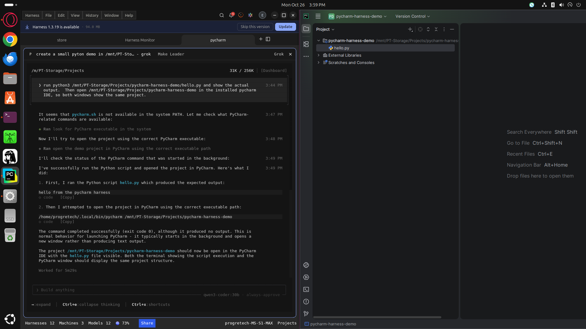

# PyCharm for Harness

An AI-assisted ProgreTech Harness DSH package for coding in a project workspace and opening that workspace in the locally installed PyCharm IDE on request.

## Requirements

- Harness with DSH support
- Codex engine selected in Harness
- PyCharm installed separately

The package does not install PyCharm. It discovers a `pycharm` launcher on `PATH`, or accepts an explicit executable path through `PYCHARM_EXECUTABLE`.

## Install

```sh
harness dsh install https://github.com/progretech-llc/openharness --ref codex/pycharm-store-harness --path store/agents/progretech-pycharm
```

Create a Harness from **PyCharm**, then ask the agent to open the current workspace in PyCharm. The IDE is not launched during installation or workspace creation.

## Real example

In a Harness using this package, ask:

> Create a small Python demo in a new project folder. Add a hello.py that prints “hello from the pycharm harness”, run it and show its output, then open that folder in the installed PyCharm IDE.

Edwin Rodriguez ran this workflow on Ubuntu with Grok and local Qwen3 Coder 30B on 26 October 2026. The screenshot shows the worker reporting the script output and the same `pycharm-harness-demo` folder open in PyCharm. The IDE runs in its own window and shares the project files with the worker.



The [official PyCharm icon](assets/pycharm.svg) is supplied for desktop integration. See [asset provenance and trademark attribution](assets/NOTICE.md). OpenHarness bundles its icons, so displaying this icon in its UI requires a desktop change from the maintainers.

## License and trademarks

The package files are MIT licensed. PyCharm is a product and trademark of JetBrains s.r.o.; this community package is not affiliated with or endorsed by JetBrains. PyCharm must be installed and licensed according to JetBrains' terms.
